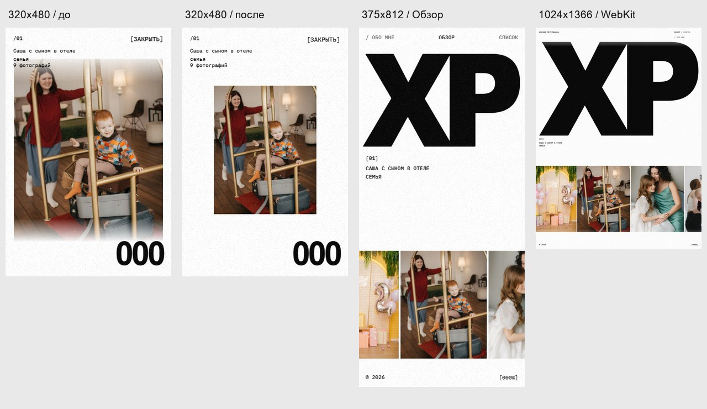

# Адаптивный рефакторинг портретной версии — 24 октября 2026

Версия для визуальной приёмки. Реальные iPhone/Safari и Android/Chrome остаются отдельной проверкой.



## Что изменено

- Единая геометрия viewport и safe areas в `src/viewport.ts`: CSS, галерея и конечный прямоугольник перелёта обложки получают одинаковые размеры. Обновления при resize объединяются в один animation frame.
- Изменения `visualViewport` обрабатываются отдельно от `window.resize`; canvas использует ту же высоту, что DOM. Pinch scale нормализуется, чтобы увеличение страницы не перестраивало композицию. Различие visual/layout viewport описано в [MDN VisualViewport](https://developer.mozilla.org/en-US/docs/Web/API/VisualViewport).
- Портретная композиция XP + caption + горизонтальная лента работает также на планшетах 1024×1366 и высоких экранах 1280×1920. Landscape с шириной от 1024px сохраняет desktop-композицию.
- XP учитывает место для подписи, фотографий и нижних контролов. Убраны отдельные, расходившиеся формулы CSS на `svh` и геометрии на `innerHeight`.
- Фото серии вписывается между fixed метаданными и счётчиком с сохранением aspect ratio. На коротком экране оно может быть уже 90vw: это необходимое ограничение высоты. До изменения на 320×480 первый кадр занимал y=60…420, перекрывая заголовок y=0…104 и счётчик y=369…480.
- Поворот сохраняет относительную позицию внутри серии. Breakpoint во время перехода применяется после завершения timeline; обложка перед передачей DOM-фотографии выравнивается по актуальному размеру кадра.
- Observer включён только у активной галереи и слушает её собственную поверхность. Горизонтальный и вертикальный swipe листают ленту; multi-touch передаётся браузеру. Native scroll серий и Info не обслуживается Observer галереи.
- Tap после свайпа не открывает случайную серию. У навигации компактного вида, Close и контактных ссылок увеличена область нажатия. Для Close отдельно обработан завершённый touch: Chrome может не прислать `click`, когда касание останавливает native inertia. `pointercancel` отменяет действие при начале прокрутки; отмена compatibility click защищает от двойного Back.
- Код GLSL, displacement, зерно, текстовые reveal, цифровые барабаны и перелёты сохранены. Reduced motion отключает также инерционное доведение галереи; DOM fallback остаётся доступным без WebGL.

## Воспроизведение

```powershell
npm run typecheck
npm test
$env:VITE_BASE_PATH='/xenia-pereladova/'
npm run build
npm run preview -- --base /xenia-pereladova/ --port 4180
```

В другом терминале, с доступной Playwright installation и system Chrome:

```powershell
$env:PLAYWRIGHT_MODULE='C:/Users/Nikita/.cache/codex-runtimes/codex-primary-runtime/dependencies/node/node_modules/playwright'
node tests/responsive-portrait.mjs http://127.0.0.1:4180/xenia-pereladova/ .asset-cache/portrait-responsive-verified
node tests/portrait-motion.mjs http://127.0.0.1:4180/xenia-pereladova/ .asset-cache/portrait-motion-verified
node tests/webkit-portrait.mjs http://127.0.0.1:4180/xenia-pereladova/ .asset-cache/portrait-webkit-verified
```

Для WebKit нужен установленный browser binary: `node <PLAYWRIGHT_MODULE>/cli.js install webkit`. Зависимости приложения не менялись.

## Матрица и границы

Итог production artifact: `index-Qums8ttM.js`, `index-B3sExovs.css`, `gallery-renderer-5BCose72.js`. [Машиночитаемые результаты и SHA-256](checks.json): **264 responsive + 416 motion + 36 WebKit = 716 PASS, 0 FAIL**, console/runtime errors `[]`. `npm run typecheck`, `npm test` (**6 PASS**) и production build с repository prefix выполнены после последних изменений исходников; `git diff --check` прошёл.

Дополнительный прямой browser-check: потеря GPU context через `WEBGL_lose_context` удаляет canvas и возвращает видимые DOM-фотографии. Оба GLSL-блока сравнены с HEAD и совпадают. Raw PNG и подробная motion-телеметрия сохранены локально в `.asset-cache/portrait-*-verified`; в репозитории оставлены итоговый JSON и компактное визуальное сравнение.

Chrome: 320×480, 320×568, 360×640, 375×812, 390×844, 430×932, 540×720, 600×800, 601×962, 768×1024, 820×1180, 1024×1366, 1280×1920, 812×375, 1024×768, 1440×900.

WebKit: 320×568, 390×844, 600×800, 768×1024, 1024×1366. Сценарии включают cold intro, Overview, List, открытие серии, Close и Info; WebGL проверяется по наличию изображений, переданных renderer.

Chrome получает trusted touch через CDP. Проверяются фактические вызовы WebGL uniforms `uSpeed` при swipe и `uAnim` при открытии, а также draw calls; это подтверждает участие shader в анимации. Дополнительные сценарии: safe-area значения 59/34px, последовательные повороты и resize через breakpoint, относительная позиция серии, переход через breakpoint во время timeline, no-WebGL и reduced motion. Отдельно инъецируется `visualViewport.resize` без `window.resize`: CSS и canvas должны перейти с 844px на 744px, а изменение scale до 2 при высоте 372px должно сохранить размеры композиции. Исходный motion-harness проверяет все 8 серий, быстрые прерывания, историю, фокус и переходы.

Chrome использует SwiftShader. WebKit запущен на Windows, поэтому не заменяет Safari/iOS. Safe areas в browser-матрице инъецированы на границе CSS-переменных; реальные вырезы, панели браузера, pinch zoom, GPU FPS и touch latency требуют физического устройства. Существующее предупреждение Vite о Three.js chunk >500kB сохраняется.

**Не проверено, проверить так:** открыть production-сборку на настоящих iPhone/Safari и Android/Chrome; пройти intro, оба направления swipe, List/Info/Close, серию с прокруткой и Close во время инерции, Back/Forward, поворот во время перелёта обложки, раскрытие и скрытие панелей браузера, pinch zoom и background/foreground. После этого нужна визуальная приёмка пользователя. Публикация в эту задачу не включена.
